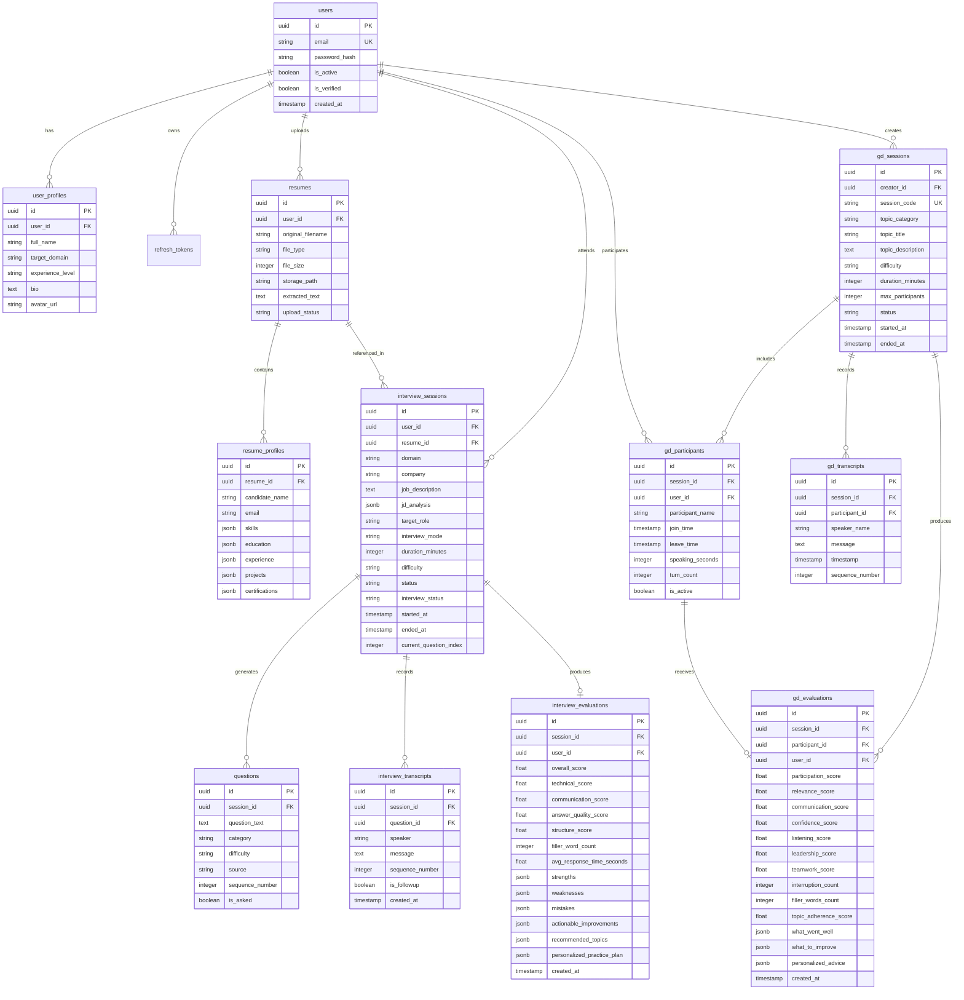
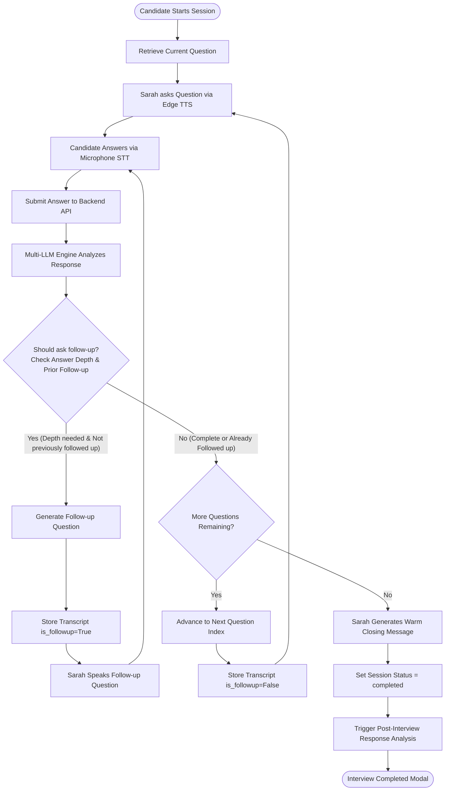
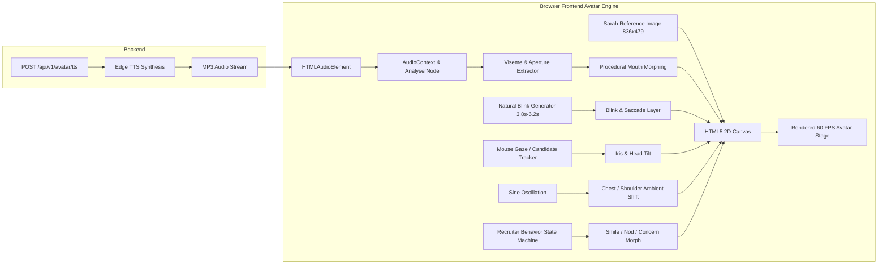

# PrepX — Complete Product Vision, Technology Stack, Architecture & Remaining Phase Plan
**Master Technical Reference Document**
*Project: PrepX — Intelligent Interview Training Platform*
*Target Hardware Environment: Intel Core i5-8365U, 16 GB RAM, Intel UHD Graphics 620 (No dedicated GPU / No CUDA)*

---

## 1. Complete Project Description

**PrepX** is an end-to-end, AI-powered interview and group-discussion preparation platform. It addresses the complete preparation journey of students and job seekers through two core operational modules:

1. **Personalized AI Mock Interview Module**:
   - The user authenticates and enters the PrepX portal.
   - The user uploads their resume (PDF/DOCX) and optionally pastes or uploads a Job Description (JD).
   - PrepX extracts key credentials, skills, projects, and role responsibilities.
   - The user configures their interview parameters (domain, target company, question focus, difficulty, and duration).
   - The system dynamically generates an interview agenda tailored to the candidate's exact profile and the company/role criteria using an abstracted multi-provider LLM chain.
   - The interview is conducted in an interactive interview room featuring **Sarah Jenkins**, a human-like AI interviewer.
   - Sarah communicates through synchronized neural voice (Edge-TTS) and realistic browser-based visual presence (natural eye gaze, saccades, blinking, nodding, smiling, and lip synchronization) optimized for standard CPU/integrated GPU hardware.
   - The interview runs dynamically: when the candidate responds via voice/text, Sarah evaluates the substance of the answer and asks adaptive, controlled follow-up questions before transitioning.
   - Upon interview completion, the session transcripts are analyzed across technical depth, communication, answer structure, and confidence indicators to produce comprehensive, traceable feedback and a visual performance report on the dashboard.

2. **AI-Powered Group Discussion (GD) Module**:
   - The user initiates a collaborative GD practice session by selecting a topic category, difficulty, duration, and participant capacity.
   - PrepX generates a unique session code and invitation link (e.g., `/gd/join/PREPX-GD-12345`).
   - The creator can share the link directly or trigger an official invite via the **Meta WhatsApp Cloud API**.
   - Peers join the live GD room using their browser with microphone access.
   - The **AI Moderator** welcomes participants, states the ground rules, introduces the topic, tracks speaking time, monitors speaker turns, ensures topical relevance, gently intervenes when necessary, provides time reminders, and concludes the session.
   - Post-GD, the platform analyzes each participant individually (participation, relevance, teamwork, leadership, listening, interruptions, filler words) and delivers individual personalized reports and analytics to each user's dashboard.

---

## 2. Current Technology Stack & Audit

| Technology | Layer | Purpose | Current Status |
| :--- | :--- | :--- | :--- |
| **Next.js (v14.2)** | Frontend | App router, server-side rendering, client page routing | **Implemented & Active** |
| **React (v18.2) & TypeScript** | Frontend | Component architecture, state management, type safety | **Implemented & Active** |
| **Tailwind CSS** | Frontend | Utility-first responsive styling and theme design | **Implemented & Active** |
| **Framer Motion** | Frontend | Micro-animations, page transitions, interactive HUD | **Implemented & Active** |
| **Lucide React** | Frontend | Iconography across UI | **Implemented & Active** |
| **Three.js / HTML5 Canvas** | Frontend | Browser-based 2D/2.5D visual rendering of Sarah avatar | **Implemented & Active** |
| **Web Speech API** | Frontend | In-browser speech-to-text (STT) for candidate responses | **Implemented & Active** |
| **FastAPI (v0.110+)** | Backend | High-performance asynchronous REST API framework | **Implemented & Active** |
| **Uvicorn** | Backend | ASGI production web server | **Implemented & Active** |
| **Pydantic (v2.6+)** | Backend | Request/response data validation and schema enforcement | **Implemented & Active** |
| **SQLAlchemy (v2.0+)** | Backend | Object-Relational Mapping (ORM) and DB repository layer | **Implemented & Active** |
| **Alembic (v1.13+)** | Backend | Database migrations management (Revisions 001–004 applied) | **Implemented & Active** |
| **PostgreSQL (15/16)** | Database | Relational database for auth, resumes, sessions, transcripts | **Implemented & Active** |
| **Argon2id & bcrypt** | Security | Cryptographic password hashing | **Implemented & Active** |
| **Python-Jose** | Security | JWT token generation, verification, and rotation | **Implemented & Active** |
| **PyPDF & python-docx** | Backend | Document parsing for uploaded resumes and JDs | **Implemented & Active** |
| **Edge-TTS (v7.2+)** | AI Speech | Free neural text-to-speech audio streaming for Sarah (`en-US-JennyNeural`) | **Implemented & Active** |
| **Google Gemini API** | AI / LLM | Primary free tier LLM provider (`gemini-2.5-flash`) | **Implemented & Active** |
| **NVIDIA NIM API** | AI / LLM | Secondary free tier failover LLM (`llama-3.2-11b-vision-instruct`) | **Implemented & Active** |
| **Groq API** | AI / LLM | Tertiary ultra-low latency failover LLM (`qwen/qwen3.8-27b`) | **Implemented & Active** |
| **OpenRouter API** | AI / LLM | Quaternary emergency fallback LLM (`openrouter/free`) | **Implemented & Active** |
| **Recharts** | Frontend | Performance analytics and interview/GD visual charts | **Planned (Phase 4 & 6)** |
| **FastAPI WebSockets** | Backend | Bi-directional real-time communication for multi-participant GD | **Planned (Phase 5)** |
| **Meta WhatsApp Cloud API** | Backend Service | Official WhatsApp Business Platform for sending GD invites | **Planned (Phase 5)** |

---

## 3. AI Technology Stack

| Component | Technology | Purpose | Fallback / Redundancy |
| :--- | :--- | :--- | :--- |
| **LLM Provider 1 (Primary)** | Google Gemini (`gemini-2.5-flash`) | Question generation, follow-up decisions, answer evaluation, GD moderation | Failover to NVIDIA NIM on 429/quota |
| **LLM Provider 2 (Secondary)** | NVIDIA NIM Cloud API (`meta/llama-3.2-11b`) | Fallback text and reasoning generation | Failover to Groq |
| **LLM Provider 3 (Tertiary)** | Groq API (`qwen/qwen3.8-27b`) | Fast sub-second inference fallback | Failover to OpenRouter |
| **LLM Provider 4 (Quaternary)** | OpenRouter (`openrouter/free`) | Final cloud LLM fallback | Graceful static template fallback |
| **Interviewer Voice (TTS)** | Microsoft Edge TTS (`en-US-JennyNeural`) | Generates realistic, natural human female voice with zero cloud API billing | Browser SpeechSynthesis API fallback |
| **Candidate Voice (STT)** | Browser Web Speech API (`webkitSpeechRecognition`) | Zero-latency local transcription of candidate voice responses | Keyboard text input modal fallback |
| **Avatar Emotion Engine** | Custom Semantic Emotion State Machine | Evaluates candidate answer sentiment and selects facial expression & gesture | Deterministic rule-based default state |
| **Avatar Lip Sync** | Audio Viseme Energy Analyzer (`AnalyserNode`) | Modulates mouth aperture and viseme shapes synchronized with audio waveform | Procedural phoneme estimation |

---

## 4. Frontend Architecture

The frontend follows Next.js App Router conventions with strong modular encapsulation:

```text
frontend/src/
├── app/
│   ├── layout.tsx                     # Root layout with providers, typography, error filters
│   ├── page.tsx                       # Landing page with platform overview & navigation
│   ├── login/page.tsx                 # Authentication (Login)
│   ├── register/page.tsx              # Authentication (Registration)
│   ├── dashboard/page.tsx             # User hub: Profile, Resume management, Past sessions
│   ├── interview/
│   │   ├── setup/page.tsx             # 4-Step wizard: Resume -> JD -> Settings -> Agenda
│   │   └── [sessionId]/page.tsx       # Live Interview Room with Sarah
│   └── gd/                            # [Phase 5]
│       ├── create/page.tsx            # GD session creation & WhatsApp invite modal
│       ├── join/[sessionCode]/page.tsx# GD guest / participant entry gate
│       └── room/[sessionId]/page.tsx  # Multi-party collaborative GD arena
├── components/
│   ├── Navbar.tsx                     # Global navigation bar with auth awareness
│   ├── ClientErrorFilter.tsx          # Suppresses non-critical browser extension warnings
│   ├── interview/
│   │   ├── AvatarProvider.tsx         # Context wrapper for avatar engine
│   │   ├── AvatarStage.tsx            # Interactive interviewer viewport & timer controls
│   │   ├── FemaleAvatar.tsx           # Canvas/CSS animated Sarah avatar presentation
│   │   ├── CandidateVideoPreview.tsx  # Local webcam video preview with mute/video toggles
│   │   ├── InterviewHUD.tsx           # Heads-Up Display: Question counter, domain, status
│   │   ├── InterviewControls.tsx      # Bottom dock: Mic, Skip, Pause, Next, End
│   │   ├── TranscriptPanel.tsx        # Scrollable live dialogue history with speaker chips
│   │   └── InterviewCompletedModal.tsx# Summary popup upon session conclusion
│   └── gd/                            # [Phase 5]
│       ├── GDStage.tsx                # Grid of participant video/audio feeds
│       ├── GDModeratorAvatar.tsx      # Sarah as the AI Moderator in GD
│       ├── SpeakerActivityIndicator.tsx# Live active speaker visualization
│       └── GDControls.tsx             # Raise hand, mute mic, leave session
├── lib/
│   ├── api.ts                         # Axios client with JWT auto-refresh interceptors
│   ├── auth.ts                        # Token storage and user session management
│   ├── interview.ts                   # REST bindings for interview lifecycle
│   ├── avatar/
│   │   ├── AvatarEngine.ts            # High-level coordinator for avatar lifecycle
│   │   ├── LocalSarah2DAvatarProvider.ts # 2D/Canvas realistic Sarah rendering
│   │   ├── VisemeEngine.ts            # Audio frequency to mouth opening mapping
│   │   └── types.ts                   # Avatar states, expressions, visemes, gestures
│   └── speech/
│       ├── BrowserSpeechToTextProvider.ts # Web Speech API wrapper
│       └── MockSpeechProvider.ts      # Testing harness for speech
└── types/                             # TypeScript interfaces (User, Session, GD, Analysis)
```

---

## 5. Backend Architecture

The backend is built as a **Modular Monolith** adhering to Clean Architecture principles:

```text
backend/app/
├── core/
│   ├── config.py                      # Pydantic BaseSettings, database URLs, API keys
│   ├── exceptions.py                  # Domain exception hierarchy (PrepXException)
│   ├── logging.py                     # Structured JSON / colored console logging
│   └── security.py                    # Argon2id hashing, JWT access/refresh token generation
├── db/
│   ├── base.py                        # Declarative Base metadata
│   └── session.py                     # SQLAlchemy sessionmaker & dependency get_db
├── models/
│   ├── user.py                        # User and UserProfile ORM models
│   ├── token.py                       # RefreshToken revocable storage
│   ├── resume.py                      # Resume and ResumeProfile (parsed metadata)
│   ├── interview.py                   # InterviewSession, Question, InterviewTranscript
│   └── gd.py                          # [Phase 5] GDSession, GDParticipant, GDTranscript
├── schemas/
│   ├── common.py                      # Standard ApiResponse[T] envelope
│   ├── user.py                        # UserCreate, UserLogin, UserRead, ProfileUpdate
│   ├── resume.py                      # ResumeRead, ResumeProfileRead
│   ├── interview.py                   # SessionCreate, RuntimeState, ResponseResult, Feedback
│   └── gd.py                          # [Phase 5] GDCreate, GDJoin, GDState, GDFeedback
├── repositories/
│   ├── user_repository.py             # User DB operations
│   ├── resume_repository.py           # Resume & profile DB operations
│   ├── interview_repository.py        # Interview session, questions, transcript queries
│   └── gd_repository.py               # [Phase 5] GD session, participant, transcript queries
├── services/
│   ├── auth_service.py                # Registration, credential checks, token rotation
│   ├── user_service.py                # Profile management
│   ├── storage_service.py             # Local disk file storage under uploads/
│   ├── extraction_service.py          # PyPDF / python-docx text extraction
│   ├── parser_service.py              # Regex + rule-based JD and Resume parser
│   ├── llm_service.py                 # Multi-LLM provider failover manager
│   ├── interview_service.py           # Interview lifecycle, follow-up logic, state machine
│   ├── evaluation_service.py          # [Phase 4] Post-interview dimensional scoring
│   ├── gd_service.py                  # [Phase 5] GD WebSocket orchestration & moderation
│   └── whatsapp_service.py            # [Phase 5] Meta WhatsApp Cloud API client
├── adapters/
│   ├── ai/                            # BaseLLMProvider implementations
│   ├── question_generator/            # MultiLLMQuestionGenerator with fallback
│   └── interview_engine/              # MultiLLMInterviewEngine with Sarah persona
└── api/
    ├── deps.py                        # FastAPI dependencies: get_current_user, etc.
    └── v1/
        ├── router.py                  # API v1 aggregator
        └── endpoints/
            ├── health.py              # Health check & provider status
            ├── auth.py                # Login, register, refresh, logout
            ├── users.py               # Profile view/update
            ├── resumes.py             # Upload, parse, profile extraction
            ├── interviews.py          # Session creation, question gen, runtime endpoints
            ├── avatar.py              # Avatar status & Edge TTS audio generation
            ├── evaluations.py         # [Phase 4] Interview scoring & feedback endpoints
            ├── gd.py                  # [Phase 5] GD session management & WebSocket endpoint
            └── whatsapp.py            # [Phase 5] WhatsApp invitation trigger
```

---

## 6. Database Architecture (PostgreSQL Schema)

The database schema utilizes PostgreSQL relational tables with UUID primary keys and JSONB indexing:



---

## 7. AI Interview & Adaptive Follow-up Architecture

The interview flow is conversational, adaptive, and constrained against runaway loops:



### Controlled Follow-up Invariant:
1. **Maximum Follow-ups Per Question = 1**: Once an answer to a follow-up is received, the prompt explicitly forces Sarah to acknowledge the points made, provide brief closure, and transition to the next question.
2. **Infinite Question Guard**: Total questions are bounded by the session duration (e.g., 15 mins = 4-5 questions; 30 mins = 8-10 questions).

---

## 8. Sarah Jenkins — Lightweight Avatar Architecture

### Target Hardware Compatibility
- **CPU**: Intel Core i5-8365U (4 Cores, 8 Threads)
- **RAM**: 16 GB DDR4
- **GPU**: Intel UHD Graphics 620 (Shared memory, no CUDA)

Because this machine cannot run local deep-learning diffusion video models (HeyGen, LivePortrait, MuseTalk, SadTalker), PrepX uses a **Client-Side Procedural 2D/Canvas Deformation Avatar Engine**:



### Behavioral States Supported:
- `IDLE`: Subtle breathing, periodic natural eye blinks, occasional saccadic micro-movements.
- `LISTENING`: Attentive forward tilt, subtle encouraging nods when candidate audio level rises.
- `THINKING`: Slight upward/side eye shift with 300ms pause before speaking.
- `SPEAKING`: Continuous mouth viseme animation synchronized directly with audio waveform frequencies.
- `ENCOURAGING / SMILING`: Slight corner-of-mouth lift, relaxed eyes.
- `CONCERNED / CORRECTIVE`: Subtle brow adjustment, focused gaze.

---

## 9. Real-Time Group Discussion (GD) Architecture

The GD module provides a realistic multi-candidate group discussion simulation with an AI Moderator:

```mermaid
flowchart TD
    Creator[Host / Creator] --> CreateGD[Create GD Session: Topic, Duration, Max 6 Peers]
    CreateGD --> GenInvite[Generate Unique Code: PREPX-GD-12345]
    GenInvite --> WhatsApp[Share via WhatsApp Cloud API / Copy Link]
    
    Peer1[Peer Candidate 1] --> JoinLink[Open /gd/join/PREPX-GD-12345]
    Peer2[Peer Candidate 2] --> JoinLink
    Creator --> JoinLink
    
    JoinLink --> WSRoom[Connect to FastAPI WebSocket /ws/gd/{session_code}]
    
    subgraph GD Session Server
        WSRoom --> RoomManager[GD Room State Manager]
        RoomManager --> AudioMixer[Voice Activity Detector / Speaker Tracker]
        AudioMixer --> TranscriptStream[Real-time Speech Transcription]
        TranscriptStream --> ModeratorAgent[AI Moderator Sarah Jenkins]
    end
    
    ModeratorAgent --> |Welcome & Rules| TTSOut[TTS Moderator Voice Broadcast]
    ModeratorAgent --> |Time Checks & Interventions| TTSOut
    TTSOut --> AllPeers[Broadcast to All Connected Peers]
    
    RoomManager --> |Timer Expired| EndGD[Conclude GD Session]
    EndGD --> GDEvalEngine[Participant Evaluation Service]
    GDEvalEngine --> IndividualReports[Personalized Individual Feedback Reports]
```

### AI Moderator Rules:
1. **Welcome & Rules**: Outlines time limits, respectful conduct, and goal of consensus.
2. **Topic Introduction**: Delivers a clear background briefing on the GD topic.
3. **Turn Monitoring**: Tracks speaking seconds per participant; identifies dominant vs silent members.
4. **Gentle Interventions**: If someone speaks for >90s continuously or interrupts repeatedly, Sarah interjects politely: *"Let's ensure everyone has an opportunity to contribute. I'd love to hear from [Participant Name]."*
5. **Time Warnings**: Gives verbal 5-minute and 1-minute notices.
6. **Debrief & Conclusion**: Summarizes main discussion threads and transitions members to their personal scorecards.

---

## 10. Meta WhatsApp Cloud API Architecture

To invite peers seamlessly, PrepX integrates with the official Meta WhatsApp Business Platform:

```text
┌─────────────────────────────────┐
│     PrepX Backend Application   │
│   (app/services/whatsapp_service)│
└────────────────┬────────────────┘
                 │ HTTPS POST (Authorized)
                 ▼
┌──────────────────────────────────────────────┐
│       Meta Graph API v19.0+                  │
│  https://graph.facebook.com/v19.0/{PHONE_ID} │
│  Headers: Authorization: Bearer {WA_TOKEN}   │
└────────────────┬─────────────────────────────┘
                 │ Official Cloud Delivery
                 ▼
┌──────────────────────────────────────────────┐
│          WhatsApp Mobile Client              │
│  "You have been invited to a PrepX GD!"      │
│  Topic: Future of Generative AI in FinTech   │
│  Session Code: PREPX-GD-12345                │
│  Join Link: https://prepx.ai/gd/join/12345   │
└──────────────────────────────────────────────┘
```

### WhatsApp Architectural Isolation:
- Stored credentials: `WHATSAPP_PHONE_NUMBER_ID`, `WHATSAPP_ACCESS_TOKEN`, `WHATSAPP_TEMPLATE_NAME`.
- Fully isolated in `app/services/whatsapp_service.py`. If credentials are omitted, the UI gracefully defaults to standard Web Share API and "Copy Link" clipboard actions without failing.
- No unofficial scraping or browser automation tools (e.g., Selenium/Puppeteer) are used.

---

## 11. Interview Data Flow

```text
User Browser
    │
    ├─► 1. POST /api/v1/resumes/upload (Multipart PDF/DOCX)
    │     └─► ExtractionService parses skills, education, projects ──► DB: resumes, resume_profiles
    │
    ├─► 2. POST /api/v1/interviews/parse-jd-text (Optional JD text)
    │     └─► ParserService analyzes required skills & duties ───────► Session Context
    │
    ├─► 3. POST /api/v1/interviews/sessions (Config: Domain, Company, Duration, Difficulty)
    │     └─► DB: interview_sessions (status: 'ready')
    │
    ├─► 4. POST /api/v1/interviews/sessions/{id}/questions/generate
    │     └─► Multi-LLM generates N structured questions ────────────► DB: questions
    │
    ├─► 5. POST /api/v1/interviews/sessions/{id}/start
    │     └─► Sarah greeting generated + Edge TTS synthesis ────────► Audio streamed to browser
    │
    ├─► 6. Web Speech API transcribes Candidate Voice Answer
    │     └─► POST /api/v1/interviews/sessions/{id}/response
    │           ├─► DB: interview_transcripts (speaker='candidate')
    │           ├─► LLM checks depth, decides follow-up vs transition
    │           ├─► Edge TTS audio returned for Sarah
    │           └─► DB: interview_transcripts (speaker='interviewer')
    │
    ├─► 7. POST /api/v1/interviews/sessions/{id}/end
    │     └─► DB: interview_sessions (status: 'completed')
    │
    └─► 8. POST /api/v1/evaluations/sessions/{id}/generate (Phase 4)
          ├─► Multi-LLM evaluates all transcripts against rubric
          ├─► DB: interview_evaluations (Scores, strengths, weaknesses, plan)
          └─► User Dashboard renders Recharts visualizations
```

---

## 12. Group Discussion (GD) Data Flow

```text
Host User
    │
    ├─► 1. POST /api/v1/gd/sessions (Create GD with topic, duration, slots)
    │     └─► DB: gd_sessions (code: 'PREPX-GD-98124', status: 'scheduled')
    │
    ├─► 2. POST /api/v1/gd/sessions/{id}/invite-whatsapp (Send WhatsApp invitations)
    │     └─► Meta WhatsApp Cloud API dispatches message with join link
    │
Peers & Host
    │
    ├─► 3. Open https://prepx.app/gd/join/PREPX-GD-98124
    │     └─► Enter name / authenticate ──► DB: gd_participants
    │
    ├─► 4. Connect WebSocket: ws://api.prepx.app/api/v1/gd/ws/{session_code}
    │     ├─► Transmit local mic audio / STT chunks
    │     ├─► Receive peer activity events & active speaker IDs
    │     └─► Receive AI Moderator audio announcements (Edge-TTS)
    │
    ├─► 5. Moderator Monitors Discussion Stream
    │     ├─► Tracks speaking turns & interruptions
    │     ├─► Performs periodic relevance checks via LLM
    │     └─► Delivers time warnings & concluding remarks
    │
    └─► 6. Session Closes (status: 'completed')
          ├─► Background Evaluation Task triggered
          ├─► Per-participant transcript isolation & LLM rubric scoring
          ├─► DB: gd_evaluations (Scores, teamwork, leadership, feedback)
          └─► Each participant receives individual scorecard on their GD Dashboard
```

---

## 13. Complete System Architecture Diagram

```text
                                  ┌────────────────────────────────────────┐
                                  │            PrepX Frontend              │
                                  │  (Next.js 14 + React + TypeScript)     │
                                  └───────────────────┬────────────────────┘
                                                      │
                                                      │ HTTPS / WSS
                                                      ▼
                                  ┌────────────────────────────────────────┐
                                  │         FastAPI Modular Monolith       │
                                  │       (Uvicorn ASGI Application)       │
                                  └─┬───────────────────┬────────────────┬─┘
                                    │                   │                │
            ┌───────────────────────┘                   │                └────────────────────────┐
            ▼                                           ▼                                         ▼
┌───────────────────────┐                   ┌───────────────────────┐                 ┌───────────────────────┐
│  Interview Subsystem  │                   │      Core Layer       │                 │     GD Subsystem      │
│ ───────────────────── │                   │ ───────────────────── │                 │ ───────────────────── │
│ • Resume Extraction   │                   │ • JWT & Argon2id Auth │                 │ • Session & Room Mgmt │
│ • JD Parser Service   │                   │ • SQLAlchemy ORM Base │                 │ • WebSocket Dispatcher│
│ • Question Generator  │                   │ • Pydantic Validation │                 │ • Turn & Time Tracker │
│ • Interview Engine    │                   │ • Storage Service     │                 │ • AI Moderator Logic  │
│ • Response Evaluator  │                   │ • Exception Handlers  │                 │ • GD Evaluator Engine │
└───────────┬───────────┘                   └───────────┬───────────┘                 └───────────┬───────────┘
            │                                           │                                         │
            │                                           ▼                                         │
            │                              ┌────────────────────────┐                             │
            │                              │  PostgreSQL Database   │                             │
            │                              │ ────────────────────── │                             │
            │                              │ • users & profiles     │                             │
            │                              │ • resumes & profiles   │                             │
            │                              │ • sessions & questions │                             │
            │                              │ • transcripts          │                             │
            │                              │ • evaluations (New)    │                             │
            │                              │ • gd_sessions (New)    │                             │
            │                              │ • gd_evaluations (New) │                             │
            │                              └────────────────────────┘                             │
            │                                                                                     │
            ├───────────────────────────────────────────┬─────────────────────────────────────────┘
            ▼                                           ▼
┌─────────────────────────────────┐         ┌─────────────────────────────────┐
│    Abstracted LLM Service       │         │    External & Speech Services   │
│ ─────────────────────────────── │         │ ─────────────────────────────── │
│ 1. Google Gemini 2.5 Flash      │         │ • Edge-TTS (Sarah Voice MP3)    │
│ 2. NVIDIA NIM (Llama 3.2 11B)   │         │ • Web Speech API (Client STT)   │
│ 3. Groq (Qwen 27B)              │         │ • Meta WhatsApp Cloud API       │
│ 4. OpenRouter Free Fallback     │         │   (Official GD Invitations)     │
└─────────────────────────────────┘         └─────────────────────────────────┘
```

---

## 14. Current Feature Implementation Audit

### Completed & Fully Operational:
- **Authentication**: User registration, login, logout, password hashing with Argon2id, JWT access & refresh token rotation, user profile update endpoints.
- **Resume Processing**: PDF/DOCX file upload, text extraction using `pypdf` and `python-docx`, structured profile parsing (skills, education, projects, certifications).
- **Job Description Parsing**: Plain text and document (PDF/DOCX/TXT) analysis extracting role, company, required skills, and core responsibilities.
- **Session Configuration**: Setup wizard linking resume, JD, domain, company, difficulty, duration, and question focus.
- **Dynamic Question Generation**: Abstracted `MultiLLMQuestionGenerator` with failover (Gemini $\to$ NVIDIA $\to$ Groq $\to$ OpenRouter $\to$ Mock fallback).
- **Interview Runtime Engine**: Interview start, initial greeting, candidate answer capture, controlled single-follow-up policy, manual skip/next, pause/resume, and session conclusion.
- **Neural Voice Integration**: Backend Edge-TTS endpoint (`/api/v1/avatar/tts`) streaming `en-US-JennyNeural` audio directly into the browser.
- **Local Sarah 2D Avatar**: Canvas-based facial rendering with blinks, head tilts, eye tracking, and audio-driven viseme aperture modulation.

### Blocked / Incomplete / Needs Polish:
- **Avatar Visual Realism**: The current avatar is functional but relies on static landmark offsets and procedurally drawn elements that can feel mechanical or unnatural under certain aspect ratios. It needs independent refinement into smooth mesh/canvas morphing without disturbing the rest of the application.
- **Response Analysis & Scoring (Phase 4)**: Currently, when an interview ends, status is set to `completed`, but automated dimensional evaluation (technical score, grammar, clarity, filler words) and persistent scorecards have not yet been implemented.
- **Interview Analytics Dashboard (Phase 4)**: Dashboard currently lists past sessions and resumes, but lacks performance graphs, trend lines, score breakdowns, and downloadable reports.
- **Group Discussion Arena (Phase 5)**: Not yet implemented in backend or frontend.
- **WhatsApp Invitation Integration (Phase 5)**: Not yet implemented.
- **GD Participant Evaluation & Scorecards (Phase 6)**: Not yet implemented.

---

## 15. Remaining Development Phases Plan

```text
Phase 0: Environment & Architecture ──► [COMPLETED]
Phase 1: Auth + Backend + DB Foundation ──► [COMPLETED]
Phase 2: Resume / JD + Config + Question Gen ──► [COMPLETED]
Phase 3: AI Interviewer + Sarah Avatar + Voice Runtime ──► [CURRENTLY IMPLEMENTED / POLISHING]
Phase 4: Response Analysis + Scoring + Interview Dashboard ──► [REMAINING]
Phase 5: Real-time GD Module + AI Moderator + WhatsApp Cloud API ──► [REMAINING]
Phase 6: GD Evaluation + Personalized Reports + Combined Dashboard ──► [REMAINING]
Final Phase: Integration Testing + Hardening + Demo Preparation ──► [REMAINING]
```

### Phase Details & Dependencies:

#### Phase 3 (Active / Polish): Sarah Avatar Visual & Voice Realism
- **Current Status**: Implemented & Functional; visual aesthetics being decoupled and polished.
- **Scope**: Refine `LocalSarah2DAvatarProvider` to achieve realistic facial deformations, natural resting state micro-motions, smooth mouth transitions, and robust browser audio synchronization.
- **Dependencies**: Completed Phase 1 & 2.

#### Phase 4 (Next): Interview Response Analysis, Scoring & Dashboard
- **Current Status**: Remaining.
- **Scope**:
  1. Create Alembic migration for `interview_evaluations` table.
  2. Implement `EvaluationService`: analyze completed session transcripts across Technical Knowledge, Answer Relevance, Communication, Clarity, Structure, Filler Words, and Confidence.
  3. Generate actionable feedback: What went well, critical mistakes, how to improve, and a personalized 7-day practice plan.
  4. Build Interview Analytics Dashboard using **Recharts** (radar charts for skill dimensions, score breakdown bars, response timeline).
- **Dependencies**: Phase 3 session completion and transcript storage.

#### Phase 5: Real-time Group Discussion (GD) & WhatsApp Integration
- **Current Status**: Remaining.
- **Scope**:
  1. Database migration for `gd_sessions`, `gd_participants`, `gd_transcripts`.
  2. FastAPI WebSocket room manager (`/api/v1/gd/ws/{session_code}`).
  3. AI Moderator engine (rules introduction, turn tracking, time warnings, interjections).
  4. Official Meta WhatsApp Cloud API client service for dispatching invite links.
  5. Next.js GD room UI with multi-participant audio/video grid and live AI Moderator avatar.
- **Dependencies**: Phase 1 auth & Phase 3 Edge-TTS / LLM service.

#### Phase 6: GD Evaluation, Personalized Feedback & Combined Dashboard
- **Current Status**: Remaining.
- **Scope**:
  1. Database migration for `gd_evaluations`.
  2. Multi-participant transcript parser evaluating Participation, Relevance, Listening, Leadership, Teamwork, and Interruptions.
  3. Individual scorecard generation for each participant.
  4. Unified user dashboard displaying both Mock Interview trends and GD performance analytics.
- **Dependencies**: Phase 4 dashboard foundation and Phase 5 GD transcripts.

#### Final Phase: Verification, Security Hardening & Academic Demo
- **Current Status**: Remaining.
- **Scope**: End-to-end integration tests, load testing for WebSocket GD rooms, verifying zero secret leaks, documentation, and live demonstration script.
- **Dependencies**: Phases 1–6 complete.

---

## 16. Security & Privacy Architecture

1. **Zero Secret Exposure**:
   - `GEMINI_API_KEY`, `NVIDIA_API_KEY`, `GROQ_API_KEY`, `OPENROUTER_API_KEY`, `SECRET_KEY`, and `WHATSAPP_ACCESS_TOKEN` exist solely in the backend `.env` file.
   - Next.js frontend connects only to the FastAPI `/api/v1` gateway; no LLM or WhatsApp keys are exposed to client bundles or browser dev tools.
2. **Authentication & Session Isolation**:
   - Access tokens are short-lived (30 minutes) JWTs.
   - Refresh tokens are hashed using SHA-256 before storage and rotated on every refresh.
   - All session, resume, and transcript endpoints verify ownership (`user_id == current_user.id`).
3. **GD Room Authorization**:
   - Session codes (e.g., `PREPX-GD-12345`) are cryptographically random.
   - Guest participants joining via WhatsApp receive signed guest session tokens preventing session hijacking.
4. **File Upload Hardening**:
   - Strict file type checking (magic bytes + extensions: `.pdf`, `.docx`, `.txt`).
   - File size ceiling capped at 10 MB.
   - Files stored in an isolated, non-executable directory with UUID-derived filenames.
5. **Git & Environment Hygiene**:
   - `.env`, `.env.local`, and uploaded documents are strictly ignored in `.gitignore`.
   - Logging filters redact all authorization headers and credentials.

---

## 17. Final End-to-End User Journey Walkthrough

```text
1. USER ONBOARDING
   • User navigates to PrepX landing page.
   • Signs up with email and password -> Argon2id hashing -> User created.
   • Profile setup: Target domain (e.g., "Data Science") and experience level.

2. PREPARATION SETUP
   • User clicks "New Interview".
   • Step 1: Uploads resume (e.g., JohnDoe_Resume.pdf) -> Extracted: Python, SQL, XGBoost, Churn Prediction.
   • Step 2: (Optional) Pastes Amazon Data Scientist Job Description -> Extracted: Distributed Systems, A/B Testing.
   • Step 3: Selects Company="Amazon", Difficulty="High", Duration=30 mins, Mode="Role-Specific".
   • Step 4: System generates 8 personalized interview questions spanning resume projects, Amazon principles, and machine learning depth.

3. INTERVIEW WITH SARAH JENKINS
   • User enters the Interview Room. Webcam preview activates.
   • Sarah Jenkins greets the candidate warmly via neural voice and introduces the first question.
   • Candidate speaks response into microphone -> Web Speech API transcribes answer live.
   • Candidate submits response -> Sarah's emotion state machine analyzes the answer:
     - Detects mention of XGBoost -> Prompts follow-up: "Why did you choose XGBoost over a logistic regression model for churn?"
     - Candidate answers follow-up -> Sarah nods, acknowledges the trade-off, and moves to Question 2.
   • At 30 minutes or all questions answered, Sarah concludes the interview.

4. INTERVIEW EVALUATION & DASHBOARD
   • Multi-LLM Evaluation Service runs asynchronous rubric analysis over the complete transcript.
   • User is directed to their Interview Report:
     - Overall Score: 84/100 (Technical: 88, Communication: 80, Structure: 82).
     - Strengths: Strong explanation of gradient boosting mechanics and data preprocessing.
     - Weaknesses: Overused filler words ("um", "like") 14 times; answer to question 4 lacked metrics.
     - Actionable Advice: Structure answers using the STAR method; prepare system design trade-offs.
   • Dashboard updates historical progress chart.

5. GROUP DISCUSSION PRACTICE
   • User clicks "Start GD Preparation".
   • Selects Topic: "Ethics and Regulation of Autonomous AI Agents", Duration: 15 mins, Max Participants: 4.
   • Clicks "Invite via WhatsApp" -> System sends invite messages with join links to 3 friends.
   • Friends click link, enter their names, and join the GD room via WebSockets.
   • AI Moderator Sarah welcomes everyone, reads ground rules, and announces the topic.
   • Friends engage in live discussion. Sarah tracks speaking time and gently intervenes if a participant is interrupted or monopolizes the conversation.
   • Discussion concludes -> Sarah summarizes the session.

6. GD EVALUATION & INDIVIDUAL REPORTS
   • Each participant immediately receives their private GD scorecard:
     - Speaking Time: 3 mins 40 secs (Well balanced).
     - Leadership Score: 8.5/10 (Constructively framed consensus).
     - Listening Score: 9.0/10 (Referenced Peer 2's point on privacy).
     - Areas to Improve: Avoid talking over others during heated exchanges.
   • Full performance record is saved to their PrepX profile.
```
